Student developer building web apps, small full-stack products and tools for real people.
I work in **JavaScript, TypeScript, React and Python**.

### Working on now

📱 **LabForge Android app**: an Android app for [LabForge](https://github.com/SHZunknown11/Lab-Forge), a lab report generator for students. I built the app with Capacitor, native downloads and AdMob rewarded ads, and added the backend support it needs.

### Projects

| Project | What it is | Stack |
| --- | --- | --- |
| [Talkify](https://github.com/ch4rannn/Talkify) | Chat application | JavaScript |
| [GameHub: All-in-One](https://github.com/ch4rannn/GameHub---All-in-One) | Tic-Tac-Toe, Hangman, Word Scramble and Chess with an XP system, profiles and a global leaderboard | Python |
| [Student Management System](https://github.com/ch4rannn/Student-Management-System) | Role-based (Admin, Teacher, Student) academic records with dashboards, grades and attendance | Python |
| [PIH-2026 Codestorm](https://github.com/ch4rannn/PIH-2026_Codestorm) | UIMS project | TypeScript |
| [Zoviq](https://github.com/ch4rannn/zoviq) | Website for Zoviq | TypeScript |
| [Ali Fruits](https://github.com/ch4rannn/ali-fruits) | Website for a fruit business | TypeScript |
| [Mochi Kitchen](https://github.com/ch4rannn/mochi-kitchen-masculine-) | Food website | JavaScript |

### Tools

### Contributions

<picture>
  <source media="(prefers-color-scheme: dark)" srcset="https://raw.githubusercontent.com/ch4rannn/ch4rannn/output/snake-dark.svg" />
  
</picture>

### Get in touch

Open an issue or a pull request on any of my repos.
